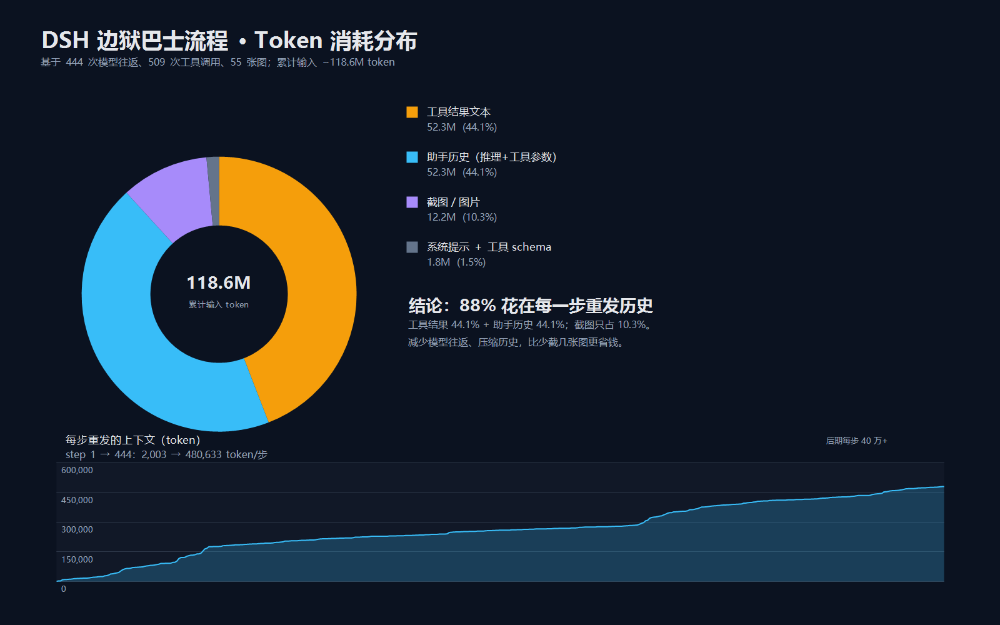

# Token 消耗分布（本会话 / 边狱巴士流程）

数据来源：当前 DSH 会话日志（`session.v4.jsonl.zstd`，解压后 7.6 MB）。
统计口径：**每一步模型请求前，把当时的系统提示、历史消息、工具结果、图片全部重发一遍**，
按字符数 ÷ 4 估算文本 token，图片按 DeepSeek 视觉上限 1024 token/张；工具 schema 按 8k 字符/步估算。



## 总量

| 指标 | 数值 |
|---|---:|
| 模型往返（step） | 444 |
| 工具调用 | 509 |
| 图片（截图/read_image） | 55 张 |
| 累计输入 token（估算） | **118.6M** |
| 平均每步上下文 | ~267k token |
| 最大单步上下文 | 481k token（第 444 步） |
| 生成 token（文本+推理+工具参数） | ~0.24M |

> 118.6M 是“如果每一步都全量重发”的输入 token 等价值；DeepSeek 的缓存命中会降低实际账单，
> 但**结构比例**不变：贵在“步数 × 当时上下文”。

## 分布

| 类别 | token | 占比 | 说明 |
|---|---:|---:|---|
| 工具结果文本 | 52.35M | **44.1%** | 文件读取、grep、命令输出、文档、日志、报告；每步重发 |
| 助手历史（推理+工具参数） | 52.29M | **44.1%** | 之前每一步的 reasoning 与 tool-call 参数；每步重发 |
| 截图 / 图片 | 12.22M | **10.3%** | 55 张图 × 1024 token，且会随历史保留 |
| 系统提示 | 0.82M | 0.7% | 固定开头 |
| 工具 schema | 0.89M | 0.75% | 10 个工具的定义 |
| 用户消息 | 0.05M | 0.04% | 36 条 |

**结论：88% 花在“每一步重发历史”**（工具结果 44.1% + 助手历史 44.1%），
截图只占 10.3%。少截几张图有用，但远不如**减少模型往返**和**压缩历史**。

## 上下文是怎么涨起来的

- 第 1 步：约 2k token；
- 第 100 步：约 20 万 token；
- 第 444 步：约 48.1 万 token。

一条长会话里，后面每一步都在为前面所有步骤付费。444 步 × 平均 267k ≈ 118M。
这也解释了为什么“只刷一场经验本”会花 ¥1–2：不是一场战斗本身贵，而是它被拆成了
几十次模型往返，每次都在重发整段历史。

## 对省钱的直接含义

| 措施 | 预计影响 |
|---|---|
| 把固定流程下沉到 `limbus_farm`（1–3 次往返） | 最大，直接把 444 步压到个位数 |
| 每次开新会话跑日常，不复用长历史 | 每步上下文从几十万降到几万 |
| 截断/摘要工具结果（长 grep、日志、文件全文） | 工具结果占 45%，压缩它直接见效 |
| 截图裁剪/缩放、只在失败时看 | 影响 10%，有用但不是主矛盾 |
| 精简工具集/系统提示 | 只占 1.5%，收益很小 |

## 复现

```powershell
# 重新生成 JSON（需要当前会话日志路径）
node docs/collect-token-context.mjs <session.v4.jsonl.zstd> docs/token-context.json

# 重新画图
powershell -ExecutionPolicy Bypass -File docs/make-token-chart.ps1
```

数据文件：[token-context.json](token-context.json)
